<div align="center">



<a href="https://github.com/Aniketchavan7">
  
</a>

<br/>

<a href="https://github.com/Aniketchavan7"></a>
<a href="https://aniketchavan7.github.io/portfolio"></a>
<a href="https://www.linkedin.com/in/aniket-chavan"></a>
<a href="https://codolio.com/profile/Aniket_chavan7"></a>
<a href="https://youtube.com/@techcodeai-e3o"></a>
<a href="mailto:caniket975@gmail.com"></a>

</div>

<br/>

```python
class Aniket:
    role       = "AI Engineer @ Aptino"            # since Oct 2026
    previously = "GenAI Intern @ Spring Money"     # multi-agent research & content pipelines
    education  = "B.E. AI & Data Science · PVG's COET, Pune · CGPA 8.34"

    focus = ["multi-agent architectures", "hybrid RAG", "real-time distributed backends"]

    milestones = [
        "GATE qualified",
        "Google Hash Code & Code Jam qualified",
        "Published research author · IJIRE",
        "1,000 LeetCode solutions & interview guides",
    ]

    def now(self):
        return "turning LLM prototypes into production systems that don't fall over"
```

<div align="center">
  <br/>
  <sub><code>// a living koi pond that grows with my daily commits</code></sub>
</div>


## `$ ls ~/stack`

<div align="center">

**🧠 ai / ml**<br/>
&nbsp;


**⚡ backend & languages**<br/>


**🎨 frontend & mobile**<br/>


**🗄️ data, cloud & tooling**<br/>


</div>


## `$ git log --projects`

| | project | what it does | stars | built with |
| :-: | :--- | :--- | :-: | :--- |
| 🚆 | **[Railway-App](https://github.com/Aniketchavan7/Railway-App)** | Real-time Indian Railway tracking with live telemetry, sub-second WebSocket updates, maps, and a grounded LangGraph travel assistant | [](https://github.com/Aniketchavan7/Railway-App) | `FastAPI` `Next.js` `LangGraph` `Redis` `MapLibre` |
| 🧠 | **[system-design-illustrated](https://github.com/Aniketchavan7/system-design-illustrated)** | Illustrated visual reference for distributed systems and system design with intuitive analogies and code | [](https://github.com/Aniketchavan7/system-design-illustrated) | `Distributed Systems` `Architecture` `Python` |
| 🧩 | **[leetcode](https://github.com/Aniketchavan7/leetcode)** | 1,000 solutions across 16 core patterns, with intuition, traces, and edge cases | [](https://github.com/Aniketchavan7/leetcode) | `Java` `Python` `Algorithms` |
| 💳 | **[YouPI-PG](https://github.com/Aniketchavan7/YouPI-PG)** | Self-hosted UPI & COD payment gateway with zero per-transaction platform fees, dynamic QR, and WhatsApp OTP verification | [](https://github.com/Aniketchavan7/YouPI-PG) | `Node.js` `FastAPI` `Docker` `FinTech` |
| 🏥 | **[claim-decision-engine](https://github.com/Aniketchavan7/claim-decision-engine)** | Four specialised LLM agents adjudicate health-insurance claims with clause-grounded audit trails | [](https://github.com/Aniketchavan7/claim-decision-engine) | `FastAPI` `LangGraph` `ChromaDB` `Docker` |
| 💸 | **[Spring Money Multi-Agent](https://github.com/Aniketchavan7/Spring_money-AI-agentic-chatbot)** | Autonomous research → draft → verify pipeline for financial content and investment analysis | [](https://github.com/Aniketchavan7/Spring_money-AI-agentic-chatbot) | `LangGraph` `LangChain` `ChromaDB` |
| 🎧 | **[No-Spoti](https://github.com/Aniketchavan7/no-spoti-releases)** | Ad-free music streaming Android app with offline playback and local caching *(public APKs)* | [](https://github.com/Aniketchavan7/no-spoti-releases) | `React Native` `Expo` `Kotlin` `SQLite` |
| ⚖️ | **[Neurosymbolic Policy QA](https://github.com/Aniketchavan7/neurosymbolic-policy-qa)** | Compiles retrieved policy clauses into typed rules and verifies answers with Z3 SMT solver *(private core)* | [](https://github.com/Aniketchavan7/neurosymbolic-policy-qa) | `LangGraph` `Z3` `BM25s` `SentenceTransformers` |


## `$ git log --author=aniket --merged upstream`

| repo | merged contribution |
| :--- | :--- |
| **[tashfeenahmed/freellmapi](https://github.com/tashfeenahmed/freellmapi)** | [#2026](https://github.com/tashfeenahmed/freellmapi/pull/2026) · increase model catalog size limit & add `CUSTOM_MODEL_CATALOG_MAX_MB` support |
| **[tashfeenahmed/freellmapi](https://github.com/tashfeenahmed/freellmapi)** | [#2025](https://github.com/tashfeenahmed/freellmapi/pull/2025) · exempt custom relays from request-wide platform skip in fallback chain |
| **[ogx-ai/ogx](https://github.com/ogx-ai/ogx)** | [#7044](https://github.com/ogx-ai/ogx/pull/7044) · map `content_filter` finish reason to `refusal` stop reason in the Anthropic translation layer |
| **[NandhaKishorM/laya](https://github.com/NandhaKishorM/laya)** | [#1515](https://github.com/NandhaKishorM/laya/pull/1515) · fix uvicorn log-level case sensitivity in the serve test suite · shipped in `v0.5.1` |


## `$ cat ~/.achievements`

<div align="center">
  <a href="https://github.com/Aniketchavan7?tab=achievements"></a>
  &nbsp;&nbsp;&nbsp;
  <a href="https://github.com/Aniketchavan7?tab=achievements"></a>
  &nbsp;&nbsp;&nbsp;
  <a href="https://github.com/Aniketchavan7?tab=achievements"></a>
</div>


## `$ top`

<div align="center">
  
  
  <br/>
  
</div>


<div align="center">
  
  <br/>
  
</div>
